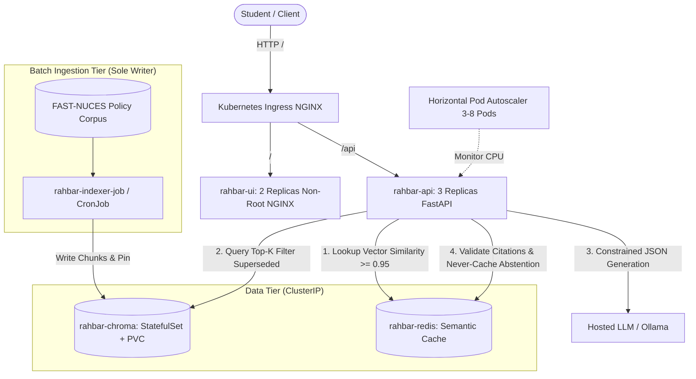

# RAHBAR: Grounded RAG on Kubernetes

[](https://github.com/aliakbar1214/rahbar-rag/actions/workflows/ci.yml)
[](https://github.com/aliakbar1214/rahbar-rag/actions/workflows/cd.yml)
[](https://github.com/aliakbar1214/rahbar-rag)
[](LICENSE)

**Course**: CS4032 Software Construction & Development — Assignment 02  
**Team Members**:
- **Syed Ali Akbar Naqvi** (24I-3079) — `sy.aliakbarnaqvi@gmail.com`
- **Huzaifa Ali** (24I-3114) — `huzaifa.ali@nu.edu.pk`

---

## 1. Problem Statement and System Overview

General-purpose large language models exhibit high fluency but lack factual ground truth regarding university-specific academic policies. When asked whether a student who failed a prerequisite can register for advanced coursework, generic models fabricate plausible but factually incorrect regulations. **RAHBAR** closes this gap by deploying an enterprise-grade, grounded question-answering architecture on **Kubernetes**. 

The system operates under the principle that **fluency is not factuality**: every answer is strictly synthesized from passages retrieved from an indexed vector database of official FAST-NUCES policies. Citations are strictly validated against retrieved evidence, outdated (superseded) policies are systematically filtered, and queries lacking supporting documentation trigger **honest abstentions** (`answered_from_context: false`).

---

## 2. System Architecture



---

## 3. API Specification

The API exposes the following endpoints (served internally on port 8000, routed via Ingress):

| Method | Endpoint | Description | Health / Dependency Rule |
|---|---|---|---|
| `GET` | `/healthz` | Process liveness probe. Returns HTTP 200 if ASGI server is responsive. | Strictly independent: touches zero external dependencies. |
| `GET` | `/readyz` | Cluster readiness probe. Returns HTTP 200 only when Chroma is connected, collection is non-empty, and collection metadata matches `EMBED_MODEL`. | Returns HTTP 503 if dependencies fail or embedding model mismatches. |
| `GET` | `/metrics` | Prometheus metrics scraping endpoint (request counters, latency histograms). | Internal metric collector. |
| `POST` | `/api/ask` | Question-answering endpoint. Takes `{"question": "..."}` and returns structured `AskResponse`. | Validates input length (3 to 500 chars), checks semantic cache, queries Chroma, invokes LLM with fallback, and verifies citations. |

---

## 4. Quick Start: Clean Clone to Answered Question

### Prerequisites
- Docker (v24+)
- Minikube or Kind cluster
- `kubectl` and `kustomize`
- Python 3.12+ (WSL 2 on Windows)

### 1. Cluster Initialization
Start Minikube with Calico CNI (required for NetworkPolicy enforcement) and enable necessary add-ons:
```bash
minikube start --driver=docker --cni=calico --memory=6144 --cpus=4
minikube addons enable metrics-server
minikube addons enable ingress
```

### 2. Configure Credentials
Create the Kubernetes Secret containing the LLM API key directly from the command line:
```bash
kubectl create namespace rahbar
kubectl create secret generic rahbar-secret -n rahbar --from-literal=LLM_API_KEY="your-llm-api-key"
```

### 3. Deploy the Stack in Exact Apply Order
Apply base infrastructure, data tiers, batch ingestion, and serving workloads:
```bash
# 1. Namespace & Configuration
kubectl apply -f k8s/base/namespace.yaml
kubectl apply -f k8s/base/configmap.yaml

# 2. Network Security Policies
kubectl apply -f k8s/base/networkpolicy.yaml

# 3. Persistent Data Tiers (ChromaDB StatefulSet + Redis)
kubectl apply -f k8s/base/chroma-statefulset.yaml
kubectl apply -f k8s/base/redis.yaml
kubectl rollout status statefulset/rahbar-chroma -n rahbar --timeout=120s
kubectl rollout status deployment/rahbar-redis -n rahbar --timeout=60s

# 4. Ingestion Job (Indexes Corpus into ChromaDB)
kubectl apply -f k8s/base/indexer-job.yaml
kubectl wait --for=condition=complete job/rahbar-indexer-job -n rahbar --timeout=300s

# 5. Serving Tier (API 3 Replicas + UI + HPA + Ingress)
kubectl apply -f k8s/base/api-deployment.yaml
kubectl apply -f k8s/base/ui-deployment.yaml
kubectl apply -f k8s/base/hpa.yaml
kubectl apply -f k8s/base/ingress.yaml
kubectl apply -f k8s/base/reindex-cronjob.yaml

# Wait for complete rollout
kubectl rollout status deployment/rahbar-api -n rahbar --timeout=180s
kubectl rollout status deployment/rahbar-ui -n rahbar --timeout=120s
```

### 4. How to Run the Indexer Manually
To trigger an on-demand re-indexing run (e.g. following corpus updates):
```bash
# Delete any previous completed job run
kubectl delete job rahbar-indexer-job -n rahbar --ignore-not-found

# Create a manual job execution from the template
kubectl apply -f k8s/base/indexer-job.yaml

# Or trigger from the weekly CronJob
kubectl create job --from=cronjob/rahbar-reindex-cronjob manual-reindex -n rahbar
```

### 5. Ask a Question
Forward the ingress or send a direct curl query to verify grounding:
```bash
curl -X POST http://rahbar.local/api/ask \
  -H "Content-Type: application/json" \
  -d '{"question": "What CGPA does an undergraduate need to stay off academic warning?"}'
```

Sample grounded JSON response:
```json
{
  "request_id": "9a1f28b4c2",
  "answer": "According to clause 5.4, an undergraduate student must maintain a minimum CGPA of 2.00 to stay off academic warning.",
  "citations": [
    {
      "source": "academic-rules-handbook-jun-2026.pdf",
      "section": "5.4 Academic Warning",
      "page": 18
    }
  ],
  "answered_from_context": true,
  "confidence": "high",
  "retrieved": [
    {
      "chunk_id": "academic-rules-handbook-jun-2026.pdf-p18-0042",
      "source": "academic-rules-handbook-jun-2026.pdf",
      "section": "5.4 Academic Warning",
      "page": 18,
      "score": 0.892
    }
  ],
  "provider": "hosted"
}
```

---

## 5. Verification and Automated Quality Gates

Run the official submission linter:
```bash
python scripts/check_submission.py
```

Run offline unit test suite:
```bash
pytest --cov=app --cov-report=term-missing api/tests indexer/tests
```

Execute evaluation gate against golden test set:
```bash
python eval/run_eval.py --api http://127.0.0.1:8000
```
