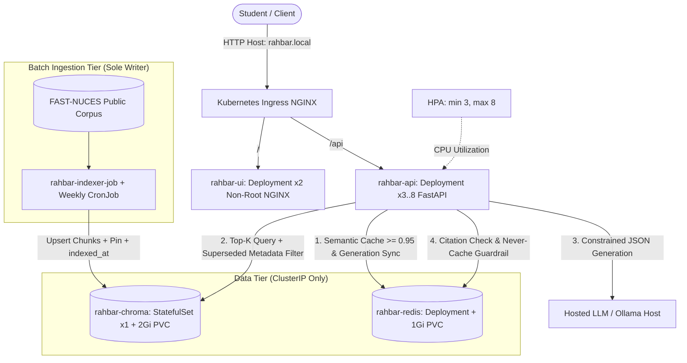

# RAHBAR: Grounded RAG on Kubernetes

[](https://github.com/ali-akbar1214/rahbar-rag/actions/workflows/ci.yml)
[](https://github.com/ali-akbar1214/rahbar-rag/actions/workflows/cd.yml)
[](https://github.com/ali-akbar1214/rahbar-rag)
[](LICENSE)

**Course**: SE3005 Software Construction & Development — Assignment 02  
**Team Members**:
- **Syed Ali Akbar Naqvi** (24I-3079) — `sy.aliakbarnaqvi@gmail.com`
- **Huzaifa Ali** (24I-3114) — `huzaifa.ali@nu.edu.pk`

---

## 1. Problem Statement and System Overview

General-purpose language models optimize for fluency, not factuality over your institution's policies. When asked whether a 5th-semester student can register for a course after failing its prerequisite, an ungrounded model invents plausible rules from unrelated universities and cannot distinguish a repealed 2023 policy from its 2026 revision.

**RAHBAR** is a grounded question-answering service over official **FAST-NUCES** regulatory documents, deployed on **Kubernetes**:
- **One Writer, One Reader, One Shared Pin**: A batch Kubernetes `Job` (and weekly `CronJob`) extracts, cleans, chunks, embeds, and indexes documents into a persistent ChromaDB `StatefulSet`. Three horizontally autoscaled (3–8) stateless FastAPI pods only read the index, gated by a `/readyz` guardrail that verifies `EMBED_MODEL` parity before serving traffic.
- **Grounded & Honest**: Answers are schema-constrained (`Answer` Pydantic contract), every `[source / section]` citation is verified against retrieved passages, superseded policies are filtered via metadata (`superseded: false` unless an older version is explicitly requested), and out-of-scope or adversarial queries abstain honestly (`answered_from_context: false`).

---

## 2. System Architecture



- **Why ChromaDB is a `StatefulSet` (not a `Deployment`)**: ChromaDB persists SQLite catalog tables and HNSW binary index segments on disk (`/data`), which cannot tolerate two pods concurrently writing or racing on a `ReadWriteOnce` PVC during a `Deployment` rolling update. A 1-replica `StatefulSet` with `volumeClaimTemplates` guarantees deterministic pod identity (`rahbar-chroma-0`) and ordered 1-to-1 PVC rebinding across restarts (see [`docs/ARCHITECTURE.md`](docs/ARCHITECTURE.md) and [`docs/adr/0001-indexer-as-job.md`](docs/adr/0001-indexer-as-job.md)).
- **Corpus Provenance & Embedding Host**: Because this repository is public, third-party FAST-NUCES PDFs are not committed to Git (`corpus/raw/` is `.gitignore`d). [`corpus/MANIFEST.md`](corpus/MANIFEST.md) records every public URL, byte count, and SHA-256 checksum alongside [`corpus/fetch.py`](corpus/fetch.py). Both the indexer Job and the API embed via the shared `EMBED_MODEL: nomic-embed-text` served by Ollama on `host.minikube.internal:11434` (while LLM generation is pluggable via `LLM_PROVIDER`: `hosted`, `ollama-host`, `ollama-incluster`, or `stub`).

---

## 3. API Specification

| Method | Endpoint | Description | Health / Guardrail Behavior |
|---|---|---|---|
| GET | `/healthz` | Process liveness probe (`HTTP 200`). | Touches **zero** external dependencies (prevents dependency slowdowns from causing restart storms). |
| GET | `/readyz` | Traffic readiness probe (`HTTP 200` / `503`). | Requires Chroma reachable, collection non-empty, `EMBED_MODEL` matching collection metadata, and Redis reachable. |
| GET | `/metrics` | Prometheus metrics endpoint. | Exports request count/latency, retrieval & generation latency, cache hits/misses/ratio, abstentions, fallbacks, and tokens in/out. |
| POST | `/api/ask` | Grounded Q&A endpoint (`3..500` chars). | Checks semantic cache, blocks prompt injection, filters `superseded` chunks, validates citations, and abstains below `RELEVANCE_FLOOR`. |

---

## 4. Quick Start: Clean Clone to Answered Question

### Prerequisites
- Docker (`v24+`), Minikube, `kubectl` (with `kustomize`), Python `3.12+`, and [Ollama](https://ollama.com) on the host for `nomic-embed-text` embeddings (plus `llama3.2:3b` if using `LLM_PROVIDER=ollama-host`).

### 1. Start Minikube (with Calico CNI) & Host Embedding Server
```bash
# Start Minikube with Calico so NetworkPolicies are enforced
minikube start --driver=docker --cni=calico --memory=6144 --cpus=4
minikube addons enable metrics-server
minikube addons enable ingress

# Run Ollama on all interfaces so pods reach host.minikube.internal:11434
OLLAMA_HOST=0.0.0.0 ollama serve &
ollama pull nomic-embed-text
ollama pull llama3.2:3b   # optional if using LLM_PROVIDER=ollama-host instead of hosted
```

### 2. Build & Load Images (or Use SHA-Pinned Docker Hub Images)
`k8s/base/` pins published SHA-tagged images (`aliakbar1214/rahbar-*:9031a74de8d0bca139e230515f3b861917f8ef42`). To build from your local checkout and load directly into Minikube (`k8s/overlays/dev`):
```bash
docker build -t rahbar-api:dev api
docker build -t rahbar-indexer:dev indexer
docker build -t rahbar-ui:dev ui
minikube image load rahbar-api:dev
minikube image load rahbar-indexer:dev
minikube image load rahbar-ui:dev
```

### 3. Create Namespace & Secret (Never Committed to Git)
```bash
kubectl apply -f k8s/base/namespace.yaml
kubectl create secret generic rahbar-secret -n rahbar \
  --from-literal=LLM_API_KEY="${LLM_API_KEY:-ollama-local}"
```
*(If running without a hosted Groq key, patch `LLM_PROVIDER` to `ollama-host`: `kubectl patch configmap rahbar-config -n rahbar --type merge -p '{"data":{"LLM_PROVIDER":"ollama-host","LLM_MODEL":"llama3.2:3b"}}'` after Step 4.1.)*

### 4. Apply Manifests in Exact Documented Order
```bash
# 4.1 Identity, Configuration & Zero-Trust NetworkPolicies
kubectl apply -f k8s/base/namespace.yaml
kubectl apply -f k8s/base/serviceaccounts.yaml
kubectl apply -f k8s/base/configmap.yaml
kubectl apply -f k8s/base/networkpolicy.yaml

# 4.2 Stateful Data Tiers (ChromaDB StatefulSet + Redis Semantic Cache)
kubectl apply -f k8s/base/chroma-statefulset.yaml
kubectl apply -f k8s/base/redis.yaml
kubectl rollout status statefulset/rahbar-chroma -n rahbar --timeout=180s
kubectl rollout status deployment/rahbar-redis -n rahbar --timeout=120s

# 4.3 One-Shot Indexer Job (auto-fetches & hashes FAST-NUCES corpus into /tmp/rahbar-corpus)
kubectl apply -f k8s/base/indexer-job.yaml
kubectl wait --for=condition=complete job/rahbar-indexer-job -n rahbar --timeout=300s

# 4.4 Stateless Serving Tier, Autoscaler, Ingress & Weekly Re-index CronJob
kubectl apply -f k8s/base/api-deployment.yaml
kubectl apply -f k8s/base/ui-deployment.yaml
kubectl apply -f k8s/base/hpa.yaml
kubectl apply -f k8s/base/ingress.yaml
kubectl apply -f k8s/base/reindex-cronjob.yaml

kubectl rollout status deployment/rahbar-api -n rahbar --timeout=180s
kubectl rollout status deployment/rahbar-ui -n rahbar --timeout=120s
```
*(Tip: `kubectl apply -k k8s/overlays/dev` applies the same stack using the locally loaded `:dev` images.)*

### 5. Re-index on Demand (Zero Downtime, Automatic Cache Invalidation)
```bash
kubectl create job --from=cronjob/rahbar-reindex-cronjob manual-reindex-1 -n rahbar
```

### 6. Ask Questions Through the Ingress
On macOS/Windows with the Docker driver, run `minikube tunnel` in a separate terminal and use `127.0.0.1` (on Linux, use `$(minikube ip)`):
```bash
INGRESS_IP="${INGRESS_IP:-127.0.0.1}"

# Grounded question -> cited answer (answered_from_context: true)
curl -s -X POST "http://${INGRESS_IP}/api/ask" \
  -H "Host: rahbar.local" \
  -H "Content-Type: application/json" \
  -d '{"question": "What CGPA does an undergraduate need to stay off academic warning?"}'

# Out-of-scope question (absent topic) -> honest abstention (answered_from_context: false)
curl -s -X POST "http://${INGRESS_IP}/api/ask" \
  -H "Host: rahbar.local" \
  -H "Content-Type: application/json" \
  -d '{"question": "What are the meal plan charges for the on-campus boys hostel?"}'
```

---

## 5. Verification, Evaluation & Submission Checks

```bash
# Offline unit tests + >=60% coverage gate (stubs only: no network, no model)
PYTHONPATH=.:api:indexer pytest --cov=app --cov-report=term-missing --cov-fail-under=60 api/tests indexer/tests

# Ruff + Mypy static analysis
ruff check api/ indexer/ eval/ corpus/
(cd api && mypy --ignore-missing-imports app)
(cd indexer && mypy --ignore-missing-imports pipeline)

# Evaluate live stack against the 16-question golden set & enforce CI regression gate
python eval/run_eval.py --api "http://${INGRESS_IP:-127.0.0.1}" --host rahbar.local

# Mechanical submission linter
python scripts/check_submission.py
```
